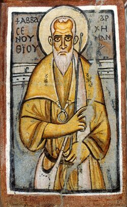

+++
title = "About this page"
+++

<figure class="marginnote">
  
  <figcaption>Shenoute of Atripe, 7th century. Public domain, via Wikimedia
  Commons.</figcaption>
</figure>

Atripe is the town Shenoute is named after; nothing much of it is left. The
tagline is only half a joke about hosting — the *Life of Shenoute* has him
carried to Ephesus and back on a cloud, which makes him the first person
from Atripe to put in a day's work without leaving home.
