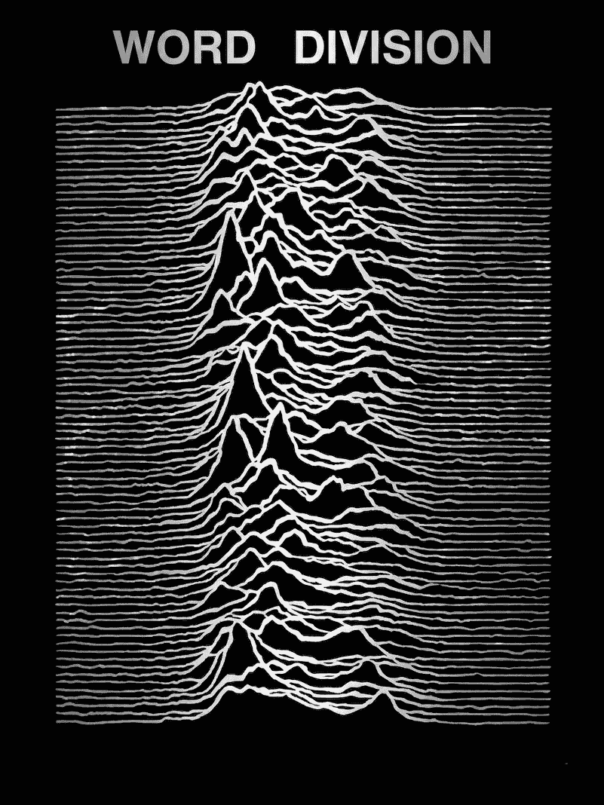

+++
title = "Word division"
description = "Segmenting Sahidic written without spaces, and writing down the conventions that decide where the breaks go."
weight = 10

[extra]
status = "Early. The conventions document is further along than the code."
+++

<figure class="cover">
  
  <figcaption>
    With apologies to Peter Saville. The original is a stack of successive
    radio pulses from CP 1919, the first pulsar found, drawn by Harold Craft
    for his 1970 Cornell thesis and reprinted in the <em>Cambridge
    Encyclopaedia of Astronomy</em> some years before Factory Records put it
    on a record sleeve. It is the right picture for this: a continuous
    signal, cut into units, stacked so that the units line up.
  </figcaption>
</figure>

Coptic manuscripts are written *scriptio continua* — letters run on without
spaces, and the reader is expected to know where one word stops. Every
modern edition therefore contains an editorial decision on every line, made
silently, and different editors make it differently. This project is an
attempt to do that segmentation mechanically for Sahidic, and to write down
the rules it is following so that they can be argued with.

## The problem is not tokenisation

It is tempting to treat this as splitting a string. It is not. The unit
that Coptic actually divides into is the **bound group**: a prosodic
cluster in which proclitics, the article, prepositions and a following noun
behave as one accented word. Printed editions almost all divide into bound
groups rather than into grammatical words, so
{{ copt(t="ⲙ̄ⲡⲣⲱⲙⲉ") }} appears as one unit even though it contains a
preposition, an article and a noun.

That means there are two different questions, and conflating them is where
most of the errors come from:

1. Where do the bound groups begin and end? This is what an edition shows.
2. Inside a bound group, where are the morphological words? This is what
   you need to look anything up in a dictionary.

The segmenter answers both, separately, and marks which of the two any
given boundary belongs to.

## Where it goes wrong

The hard cases are the ones you would expect from any language written
without spaces, plus a few of Coptic's own:

- **Ambiguity that the orthography does not resolve.** The same string of
  letters can be two different bound groups, and only sense decides.
- **The supralinear stroke.** It marks a consonant carrying its own
  syllable, which is prosodic information — exactly what bound-group
  division depends on — and it is inconsistently written in the manuscripts
  and inconsistently encoded in the transcriptions.
- **Greek loanwords**, which keep Greek morphology and do not decline the
  way the surrounding Coptic does.
- **Damaged text.** A lacuna in the middle of a group is not a boundary,
  but a naive splitter will treat it as one.

## Conventions before code

The more useful half of this is a document setting out which convention is
being applied at each decision point, with worked examples and a note on
which published editions do it differently. The code is an implementation
of that document; if the two disagree, the document is right and the code
is a bug.

## Related work

[Coptic Scriptorium](https://copticscriptorium.org) has done the most
serious work in this area and their tools are the ones to reach for if you
need results today. This is not a replacement for them. It exists because
I wanted the conventions written down separately from any one
implementation, in a form that a person editing a text by hand can also
follow.
